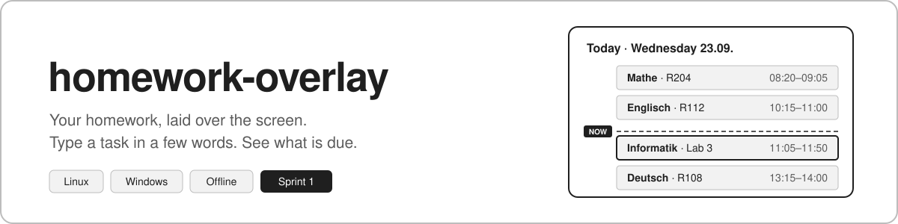
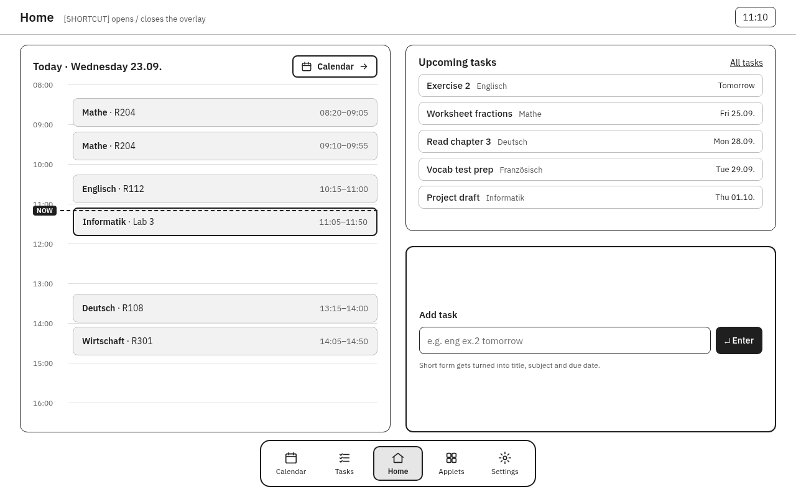
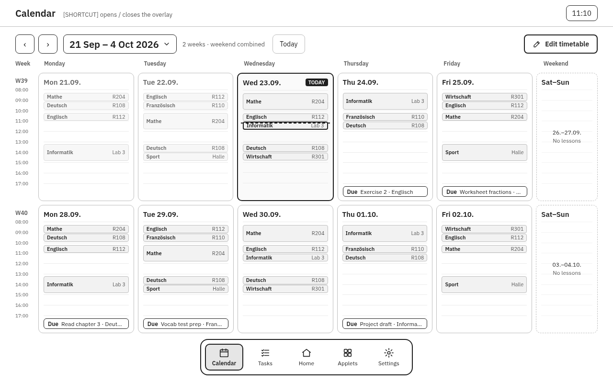
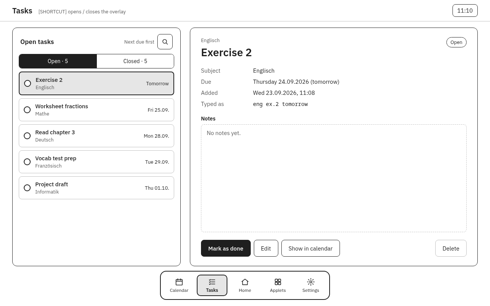
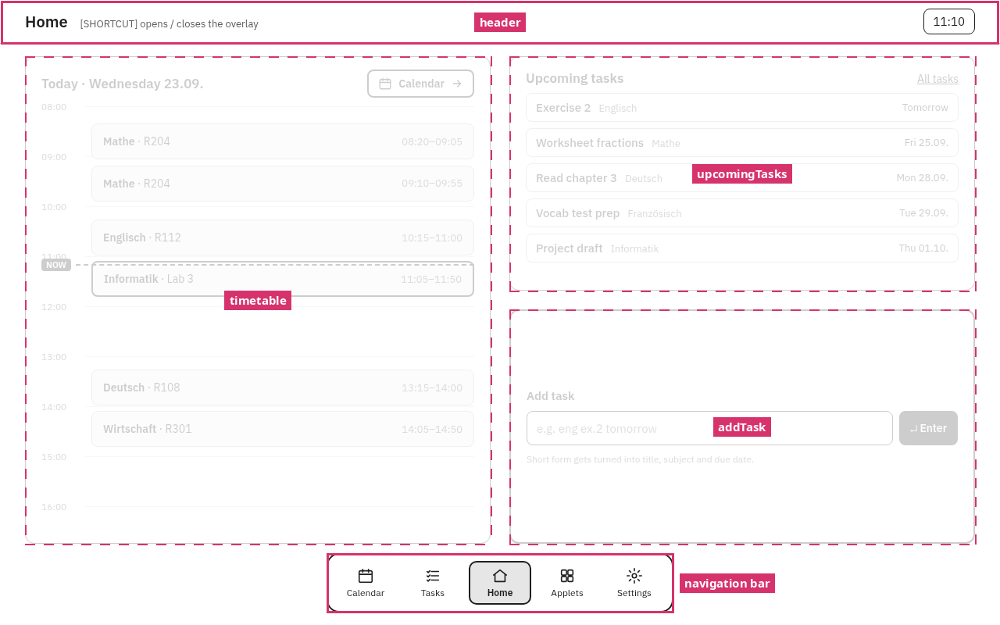
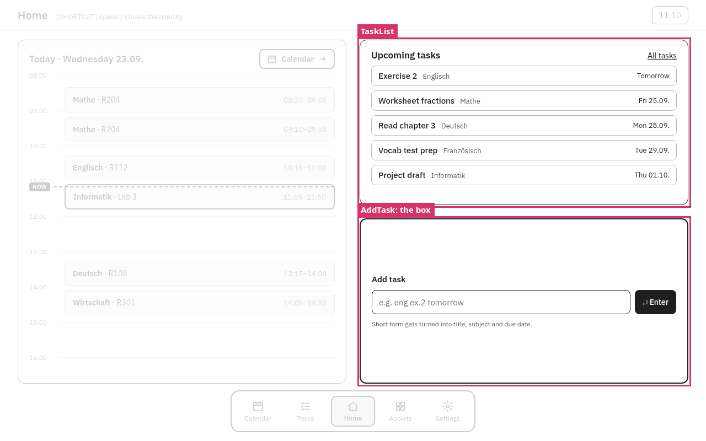
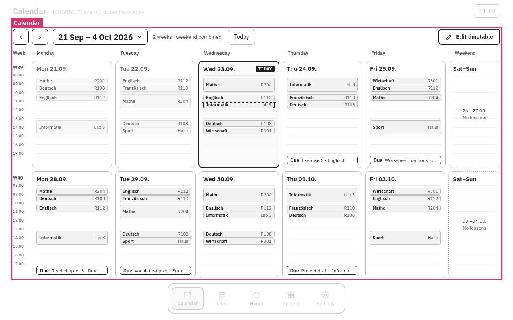
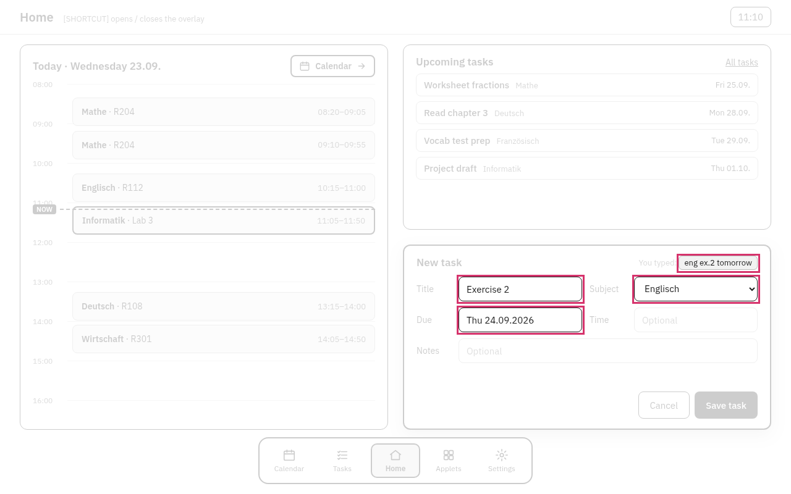
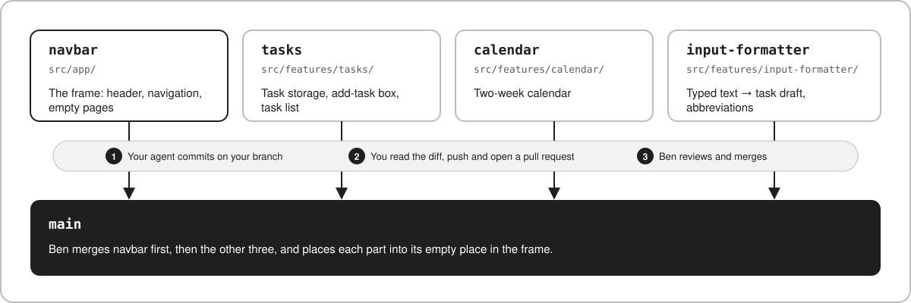

<div align="center">



<br><br>


<br><br>

<table>
  <tr>
    <td width="33%"></td>
    <td width="33%"></td>
    <td width="33%"></td>
  </tr>
  <tr>
    <td align="center"><sub><b>Home</b></sub></td>
    <td align="center"><sub><b>Calendar</b></sub></td>
    <td align="center"><sub><b>Tasks</b></sub></td>
  </tr>
</table>

</div>

## Sprint 1

Four parts, built at the same time. One branch, one folder and one brief each.

<table>
  <tr>
    <td width="50%" valign="top">
      
      <br>
      <b><code>navbar</code></b> &nbsp;·&nbsp; morris
      <br>
      <sub>The frame: header, navigation, empty pages</sub>
      <br>
      <sub><a href="briefs/navbar.md">Brief</a> &nbsp;·&nbsp; <code>src/app/</code></sub>
    </td>
    <td width="50%" valign="top">
      
      <br>
      <b><code>tasks</code></b> &nbsp;·&nbsp; alex
      <br>
      <sub>Task storage, add-task box, task list</sub>
      <br>
      <sub><a href="briefs/tasks.md">Brief</a> &nbsp;·&nbsp; <code>src/features/tasks/</code></sub>
    </td>
  </tr>
  <tr>
    <td width="50%" valign="top">
      
      <br>
      <b><code>calendar</code></b> &nbsp;·&nbsp; elio
      <br>
      <sub>Two-week calendar</sub>
      <br>
      <sub><a href="briefs/calendar.md">Brief</a> &nbsp;·&nbsp; <code>src/features/calendar/</code></sub>
    </td>
    <td width="50%" valign="top">
      
      <br>
      <b><code>input-formatter</code></b> &nbsp;·&nbsp; josh
      <br>
      <sub>Typed text to task draft, abbreviations</sub>
      <br>
      <sub><a href="briefs/input-formatter.md">Brief</a> &nbsp;·&nbsp; <code>src/features/input-formatter/</code></sub>
    </td>
  </tr>
</table>

## Getting started

```sh
git clone https://github.com/sirBenhenry/homework-overlay.git
cd homework-overlay
git switch <your branch>   # navbar, tasks, calendar or input-formatter
npm install
npm run app                # first run downloads Electron, about 100 MB
```

Then read your brief and start your agent in this folder. It finds its job from the branch name.

## How it fits together



> [!IMPORTANT]
> Something unclear or missing in your brief? Ask Ben. Do not let your agent guess.

## Handing in your part: a pull request into `main`

**1. Check it.** Your agent goes through "Done when" in your brief and runs `npm run lint`, `npm test` and `npm run build`. You look at your part on the preview page and read the whole diff:

```sh
git diff main...HEAD
```

**2. Push your branch.**

```sh
git push -u origin <your branch>   # later pushes: just git push
```

**3. Open the pull request.** On the [repo page](https://github.com/sirBenhenry/homework-overlay), click **Compare & pull request** in the yellow bar that appears after your push. No bar? Go to **Pull requests → New pull request** and pick:

| base | compare |
|---|---|
| `main` | your branch |

**4. Fill it in.** Give it a short title like `Add the two-week calendar`. The description is a template with three questions: what changed, how it was checked (paste what lint, test and build printed), and anything the reviewer should know. Tick the three boxes at the bottom only if they are true.

**5. Click Create pull request.** Ben reviews it. Do not merge it yourself.

**6. Changes asked for?** Let your agent fix them on the same branch, then `git push`. The pull request updates by itself, so do not open a new one.

## Commands

| | |
|---|---|
| `npm run app` | Open the app in its desktop window |
| `npm run dev` | Dev server only, for the preview page at `localhost:5173/preview.html` |
| `npm test` | Run all tests |
| `npm run lint` | Check the code |
| `npm run build` | Type-check and build |

## Definition of done

A card moves to Done when it meets all acceptance criteria, was tested, matches the wireframe and has comments or documentation.

<br>

<div align="center">

**[Team guide](docs/guide.md)** &nbsp;·&nbsp; **[Wireframe](docs/wireframe/README.md)** &nbsp;·&nbsp; **[Rules for agents](AGENTS.md)**

<sub>The team guide has the full workflow, the commandments, the folders, shared code, the preview page, tests and stored data.</sub>

</div>
