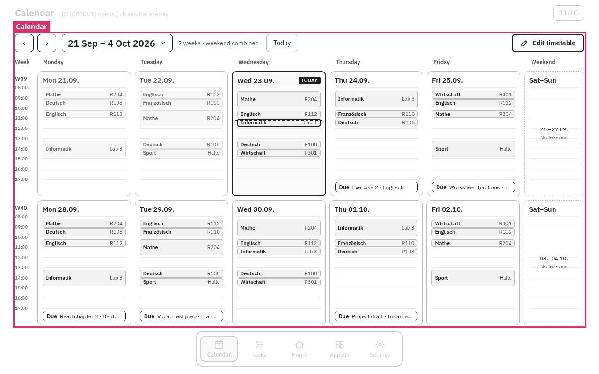

# Brief: calendar

| | |
|---|---|
| Branch | `calendar` |
| Your folder | `src/features/calendar/` |
| Trello card | Kalenderansicht (L) |

## What you build

One drop-in component: the two-week calendar. It shows the lessons and the tasks it is given and stores nothing itself. You do not put it into the app. Ben places it into the frame after the merge. Until then you look at it on the preview page.

## User story

> Als Nutzer möchte ich eine Kalenderansicht haben, um eine Übersicht über alle Aufgaben zu haben.

Acceptance criteria:

- Kalender hat eine 2-Wochenansicht.
- Kalender zeigt die Aufgaben, die zu erledigen sind.
- Samstag und Sonntag werden zusammen angezeigt.

## Your part of the wireframe

The whole wireframe is in `docs/wireframe/` and you may look at all of it. Your part is the content area of screen 03: everything between the header and the navigation bar.



The exact sizes are in `docs/wireframe/source/03-calendar-2-weeks.html`, inside `<main>`. The script at the bottom of that file shows how the lessons are placed.

From top to bottom, 10 px apart:

**Toolbar** (40 px high, 8 px between its elements)

- `‹` and `›`: 40 × 40 px, 1 px strong outline, 8 px radius, 18 px text.
- The range label, 20 px, weight 600. The wireframe draws it as a button with an arrow that opens the date picker. In this sprint it is plain text with no outline and no arrow.
- The hint `2 weeks · weekend combined`, 13 px, muted.
- `Today`: 40 px high, 1 px normal outline (`--color-border`), 8 px radius, 14 px text.
- The `Edit timetable` button on the right is left out.

**Column headings** (20 px high, 12 px text, weight 600, muted)

- `Week` over the week column, `Monday` to `Friday` over the day cells, `Weekend` over the weekend cell. The text starts 12 px inside its column.

**Two week rows** (they share the remaining height equally and are 8 px apart, with 8 px between the cells of a row)

- **Week column**, 40 px wide: the week label like `W39` (12 px, weight 600, muted). Below it the hours `08:00` to `17:00` (10 px, muted), each next to its line of the hour scale.
- **Five day cells** of equal width: 10 px radius, padding 8 × 10 px, 1 px normal outline, white. Each has three areas:
  - a top line, 20 px high, with the date like `Mon 21.09.` (15 px, weight 600),
  - the hour scale in all the remaining height, where 08:00 is the top edge and 17:00 the bottom edge, with a thin line (`--color-line`) at every full hour,
  - a bottom line, 22 px high, with the `Due` chips.
- **Today's cell**: 2 px strong outline, the fill `--color-fill-subtle`, and the badge `TODAY` at the top right (11 px, weight 600, white on dark, 4 px radius).
- **Days before today**: the date and the lesson text in `--color-text-past`, and paler lesson blocks (fill `--color-fill-subtle`, outline `--color-line`).
- **Lesson block**: reaches from its start to its end time on the hour scale. Fill `--color-fill`, 1 px normal outline, 4 px radius, 11 px text: the subject in weight 600 on the left, the room muted on the right. A subject that is too long ends with `…`.
- **Now**: a dashed 2 px line across today's cell at the current time. The lesson running at that time has a 2 px strong outline.
- **Due chip**: 1 px strong outline, 6 px radius, 12 px text: `Due` in weight 600, then `title · subject`.
- **Weekend cell**: 0.6 times as wide as a day cell, with a dashed 1 px outline and 10 px radius. `Sat–Sun` at the top (15 px, weight 600). In the middle, centred over faint hour lines, the dates like `26.–27.09.` (12 px) and `No lessons` (12 px, muted). At the bottom its `Due` chips, which show `Due` and the title.

**Placing a lesson:** the hour scale covers 540 minutes. A block starts at (minutes after 08:00) ÷ 540 of the scale's height and is (length in minutes) ÷ 540 of it high.

**On this screen, but not yours**

- The header and the navigation bar. They belong to `navbar`.
- The `Edit timetable` button and the screen behind it (06).
- The date picker (screen 04), the day view (05) and the weekend view (07). The wireframe makes the range label and the cells clickable for them. Not in this sprint.

## What you deliver

Exported from `src/features/calendar/index.ts`. The types `Task`, `Lesson`, `IsoDate` and `TimeOfDay` come from `src/shared/types.ts`. Use the helpers in `src/shared/dates.ts` for date arithmetic.

```tsx
<Calendar tasks={tasks} lessons={lessons} today={today} now={now} />
```

| Prop | Type | Meaning |
|---|---|---|
| `tasks` | `Task[]` | All tasks. The calendar picks the ones to show. |
| `lessons` | `Lesson[]` | The weekly timetable, one entry per lesson. |
| `today` | `IsoDate`, optional | The current day. Without it the real current day is used. |
| `now` | `TimeOfDay`, optional | The current time. Without it the real current time is used. |

Layout:

- The component fills the place it is put in (full width and height). In the wireframe that place is 1216 × 624. It must not depend on the size of the window.
- It shows two weeks, Monday to Sunday. At the start the first week is the one that contains `today`.

Toolbar:

- `‹` and `›` move the view one week back and forward. `Today` returns to the start view.
- The range label reads like `21 Sep – 4 Oct 2026`. In this sprint it is plain text, with no arrow and no click.
- The hint `2 weeks · weekend combined` as in the wireframe.

Grid:

- Column headings: Week, Monday to Friday, Weekend.
- Each week row starts with the week label like `W39` (ISO week number) and the hour scale from 08:00 to 17:00.
- **Day cell:** the date like `Mon 21.09.`. Today has the `TODAY` badge and the strong outline. Days before today are greyed as in the wireframe.
- **Lessons:** each lesson of that weekday sits at its time on the hour scale and shows subject and room. Lessons of the same subject that follow each other are drawn as one block.
- **Now:** on today's cell the dashed line marks `now`, and the lesson running at `now` gets the strong outline.
- **Tasks:** at the bottom of the day cell, one chip per open task (`done` is `false`) that is due on that day: `Due` and then `title · subject`, or only the title when the task has no subject. Text that is too long ends with `…`. Several chips are stacked.
- **Weekend cell:** Saturday and Sunday share one cell: `Sat–Sun`, the dates like `26.–27.09.`, `No lessons`, and the chips of tasks due on either day.
- Done tasks are not shown.

The calendar reads only its props. It does not use `localStorage` and does not import anything from the other parts.

## Input and output

- **In:** `tasks` come from the task storage on the `tasks` branch, and `lessons` from a timetable that does not exist yet. You have neither on your branch: use `SAMPLE_TASKS`, `SAMPLE_LESSONS`, `SAMPLE_TODAY` and `SAMPLE_NOW` from `src/shared/sampleData.ts`.
- **Out:** nothing. The calendar only shows.
- After the merge Ben places it like this, so keep the name and the props exactly as written here:

  ```tsx
  <Calendar tasks={tasks} lessons={lessons} />
  ```

## Not part of this

- The date picker (screen 04).
- The day view and the weekend view (screens 05 and 07). The cells are not links.
- Editing the timetable (screen 06). Leave out the `Edit timetable` button.
- Adding, changing or finishing tasks.
- The header and the navigation bar. They belong to the `navbar` branch.
- No file outside `src/features/calendar/`.

## Preview and tests

Create `src/features/calendar/Preview.tsx` with a default export. Show the calendar with the four sample values in a box of 1216 × 624. Then run `npm run dev` and open `http://localhost:5173/preview.html?feature=calendar`. It should look like the content area of screen 03.

Write tests next to your code. At least, with `today` = `2026-09-23`:

- The view shows 21 Sep to 4 Oct 2026 and the weeks W39 and W40.
- `›` shows 28 Sep to 11 Oct 2026, and `Today` returns.
- `Exercise 2` appears in the cell of Thu 24.09. and in no other cell.
- A task due on a Saturday or a Sunday appears in the weekend cell of that week.
- A done task does not appear.
- Two lessons of the same subject in a row are one block, and two different subjects are two blocks.

## Done when

- Every acceptance criterion above is met.
- `npm run lint`, `npm test` and `npm run build` pass.
- On the preview page the calendar matches screen 03.
- The code has comments where a reader would otherwise have to guess.
- Your human has looked at it on the preview page and agrees.
