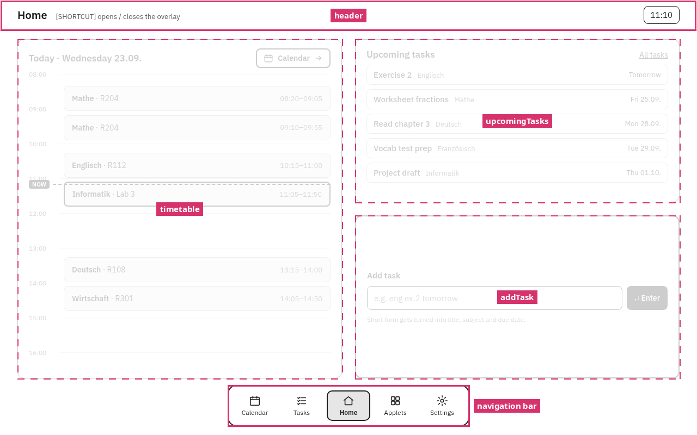

# Brief: navbar

| | |
|---|---|
| Branch | `navbar` |
| Your folder | `src/app/` |
| Trello card | Navbar (S) |

## What you build

The frame of the app: the header, the navigation bar and five empty pages. The result is a blank slate. It contains no task list, no calendar and no add-task box. The other three branches build those as separate parts, and after all branches are merged Ben puts them into the empty places you leave.

## User story

> Als Nutzer will ich eine navbar um einfach und schnell zwischen verschiedenen Tabs/Funktionen wechseln zu können.

Acceptance criteria:

- selbsterklärende Icons
- nicht im Weg
- gut strukturiert

## Your part of the wireframe

The whole wireframe is in `docs/wireframe/` and you may look at all of it. Your part is the frame that is the same on all 12 screens, and the position of the content areas. Nothing inside a content area is yours.

Solid outline: what you build. Dashed outline: the empty places you leave, with their prop names. The same picture for a page with a single place is `docs/wireframe/parts/navbar-calendar.png`.

The exact sizes and the icons are in `docs/wireframe/source/01-home.html`, in the elements `<header>` and `<nav aria-label="Main navigation">`.

**Header** (every screen, at the top)

- Full width, 56 px high, 32 px free on the left and right, and a 1 px line below it (`--color-border`).
- Left: the page title, 20 px, weight 600. 16 px to its right, on the same baseline, the hint in 13 px, muted.
- Right: the clock in a box with a 1 px strong outline and 8 px radius, 15 px text, digits of equal width.
- The titles in the wireframe: Home, Calendar, Tasks, Applets, Settings.

**Navigation bar** (every screen, at the bottom)

- Centred, 16 px above the bottom edge. A white box with a 2 px strong outline, 16 px radius, 8 px padding and 6 px between the items.
- An item is 80 × 56 px with 10 px radius: a 22 px icon above a 12 px label.
- The current item has the fill `--color-fill-active`, a 2 px strong border and its label in weight 600. The other items have no fill and no visible border.
- Order and icons: Calendar (calendar sheet), Tasks (checklist), Home (house), Applets (four squares), Settings (gear). Take the SVG shapes from the source file. `sc-camel-view-box` there means `viewBox`.

**Content area** (every screen, between header and navigation bar)

- It starts 72 px from the top, ends 104 px above the bottom, and is 32 px away from the left and right edge. At 1280 × 800 that is 1216 × 624 px.
- Home (screen 01): the left half is `timetable`. The right half is split into `upcomingTasks` above and `addTask` below. Each column is 596 px wide and each box on the right 300 px high, with 24 px gaps.
- Calendar (screen 03), Tasks (08), Applets (10) and Settings (12): one place, `content`, that fills the content area.

**On these screens, but not yours**

- Everything the wireframe shows inside the content areas: the timetable, the task boxes, the calendar, the task list and details, the applet tiles, the settings rows.
- Screens 02, 04 to 07, 09 and 11 show other parts in other states inside the same frame. They add nothing to your part.

## What you deliver

### 1. The frame: `App` in `src/app/App.tsx`

- It fills the app window. The window opens at 1280 × 800, and at that size the frame matches the wireframe. When the window is resized, the frame follows.
- **Header**: the name of the current page, the hint `[SHORTCUT] opens / closes the overlay` exactly as written (the shortcut itself is not built), and a clock on the right that shows the current time as `HH:MM` and stays current.
- **Navigation bar**: bottom centre, five items in this order: Calendar, Tasks, Home, Applets, Settings. Each has the icon from the wireframe and a label.
- The item of the current page is highlighted as in the wireframe and has `aria-current="page"`.
- Clicking an item shows its page. The app starts on Home.
- The items are real buttons: reachable with Tab, usable with Enter and Space.
- The current page is kept in React state. No router library.

### 2. Five empty pages with named places

Each page is a component that only lays out empty places for the other parts. A place is a prop of type `ReactNode`:

| Page | Prop | Position in the wireframe |
|---|---|---|
| Home | `timetable` | Left half of the content area ("Today") |
| Home | `upcomingTasks` | Right half, upper box |
| Home | `addTask` | Right half, lower box |
| Calendar | `content` | Whole content area |
| Tasks | `content` | Whole content area |
| Applets | `content` | Whole content area |
| Settings | `content` | Whole content area |

- The content area is 32 px from the left and right edge, starts 72 px from the top and ends 104 px above the bottom.
- Home has two columns of equal width with a 24 px gap. The right column has two rows of equal height with a 24 px gap.
- **An empty place** shows a dashed outline with its prop name in muted text, so the blank app shows where things will go.
- **A filled place** shows only what it was given. The page adds no border, heading or padding around it: every part draws its own panel and fills the place completely.
- `App.tsx` is the only file that hands content to the pages. In this sprint it hands over nothing, so every place is empty.

## Input and output

Your part exchanges no data with the others. Your contract is the table above: the page names and the prop names. Ben uses exactly these names when he places the parts, so do not rename them.

## Not part of this

- No components of other parts: no task list, no add-task box, no dialog, no calendar, no timetable, no applets, no settings controls.
- No example content inside the pages. They stay empty.
- No shortcut handling and no opening or closing of the overlay.
- Nothing about the desktop window itself: its size, title bar or behaviour. That is `electron/`, which is not your folder.
- No router library and no other new dependency.
- No file outside `src/app/`.

## Preview and tests

Your part is the app itself: `npm run app` opens it in the desktop window and reloads it when you save a file. You need no `Preview.tsx`.

Write tests next to your code (`*.test.tsx`). At least:

- The app starts on Home, and Home is marked as the current page.
- Clicking each of the five items shows its page and moves the highlight.
- Every place shows its name while it is empty.
- A page shows the content handed to a place instead of the empty outline.

## Done when

- Every acceptance criterion above is met.
- `npm run lint`, `npm test` and `npm run build` pass.
- In the app window (`npm run app`) the frame matches the wireframe.
- The code has comments where a reader would otherwise have to guess.
- Your human has looked at it in the app window and agrees.
